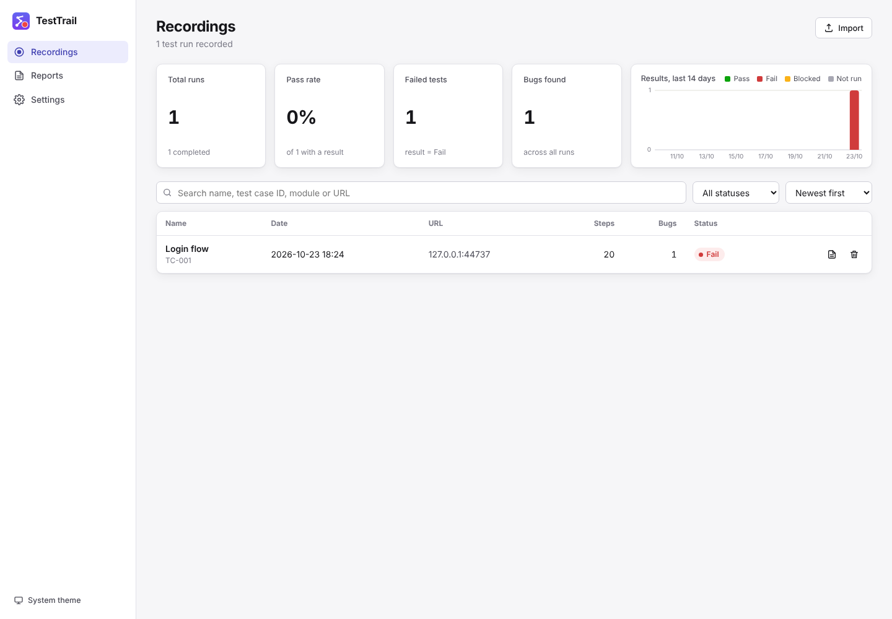
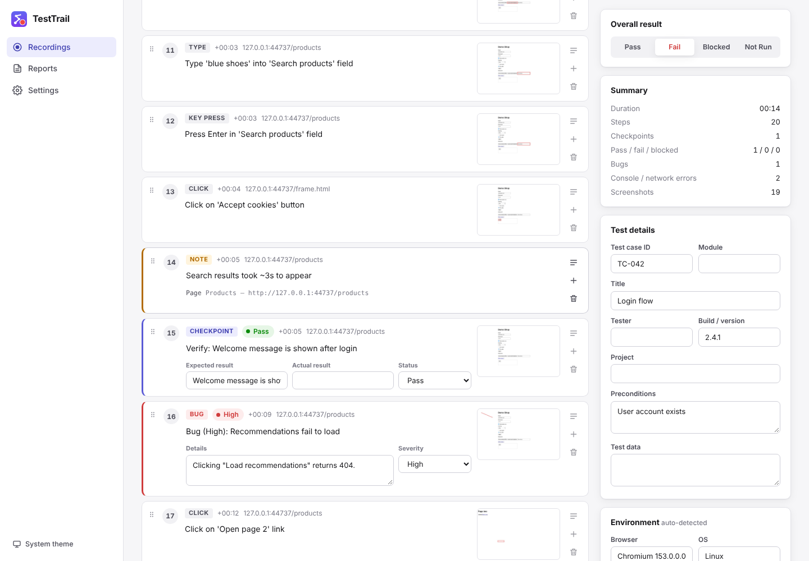
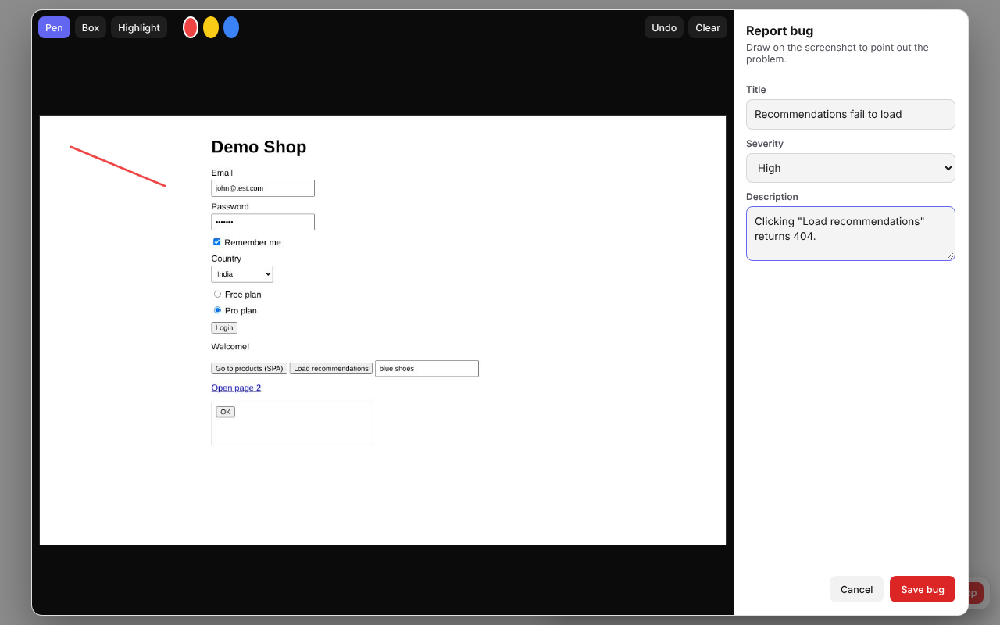

# TestTrail

A Chrome extension (Manifest V3) for manual QA testers. It records the steps you take on any website, including clicks, typing, dropdowns, navigation, notes, checkpoints and bugs. It turns them into a test report you can export as HTML, PDF, Excel, CSV or JSON, or paste into a bug ticket.

Vanilla JavaScript, **no build step**: the repository folder *is* the extension.

| Dashboard | Recording detail |
| --- | --- |
|  |  |



## Install (load unpacked)

1. Clone or download this repository.
2. Open `chrome://extensions` in Chrome (or any Chromium browser: Edge, Brave, Arc).
3. Turn on **Developer mode** (top-right toggle).
4. Click **Load unpacked** and select the repository folder (the one containing `manifest.json`).
5. Pin TestTrail from the puzzle-piece menu so the icon is always visible.

After pulling changes, click the reload icon on the TestTrail card in `chrome://extensions`.

> Pages that were already open before you installed the extension work fine. TestTrail injects its recorder when you start recording.

## How to use

### Record a test

1. Open the site you want to test.
2. Click the TestTrail icon, enter a **scenario name** (and optionally a test case ID), then click **Start recording**. You can also press **Alt+Shift+R** to start right away with an auto-generated name.
3. Test as usual. Every action becomes a numbered step with a readable description, for example:
   - `Click on 'Login' button`
   - `Type 'john@test.com' into 'Email' field` (one step per field; password fields show as `••••••`)
   - `Select 'India' from 'Country' dropdown`, `Check 'Remember me' checkbox`
   - `Navigate to 'Products' (https://…/products)` (full page loads and SPA route changes)
   - `Press Enter in 'Search' field`, `Submit form`, and optionally scrolling
4. Use the floating toolbar at the bottom-right of the page. You can drag it by its handle.
   - **Pause / Resume**: actions are ignored while paused (**Alt+Shift+P**).
   - **Note**: adds a free-text step.
   - **Checkpoint**: write the expected result (and optionally the actual result), then mark **Pass**, **Fail** or **Blocked**.
   - **Bug**: takes a screenshot that you can draw on with pen, box and highlight tools. Then add a title, severity (Critical/High/Medium/Low) and description.
   - **Stop**: ends the recording and opens it in the dashboard.

Each step also stores a CSS selector, XPath, element label/text, value, page URL, page title, a timestamp and a screenshot of the visible tab with the element outlined in red. Console errors and failed network requests (4xx/5xx) are captured and attached to the nearest step.

Recording continues across reloads and navigations in the same tab, and when Chrome restarts the extension's service worker.

### Dashboard

Open it from the popup (**Open dashboard**). It has three sections.

- **Recordings**: summary stats (total runs, pass rate, failed tests, bugs found), a results chart for the last 14 days, and a searchable, filterable list.
- **Recording detail**: the step timeline with screenshots (click one to enlarge, use ←/→ to browse).
  - Edit any description inline.
  - Drag steps by the handle to reorder them.
  - Insert manual steps (**+**) or delete steps.
  - Open **Details** on a step to set expected/actual result and status, and to see its selectors.
  - Fill in test metadata: test case ID, title, module, preconditions, test data, tester, build/version, project.
  - Check the auto-detected environment (browser, OS, screen and viewport size).
  - Set the **overall result**. A result is suggested from checkpoints and bugs.
- **Reports**: generate a report for any recording, and see the history of exports.
- **Settings**:
  - Turn screenshots, scroll capture, console and network capture on or off.
  - Set the typing debounce.
  - Set the default tester name, project name and a report logo.
  - Choose the theme (system/light/dark).
  - Data management: export all, import, clear all, and a storage usage indicator.

### Reports and exports

From a recording or its report page:

| Format | What you get |
| --- | --- |
| **HTML** | Self-contained report with all screenshots embedded as base64, which you can email or attach as-is. |
| **PDF** | Opens the print dialog with a print stylesheet. Choose **Save as PDF**. |
| **Excel (.xlsx)** | Workbook with *Summary*, *Steps* and *Errors* sheets. |
| **CSV** | The step table (UTF-8 with BOM so Excel opens it correctly). |
| **JSON** | All raw data including screenshots. Re-importable via **Import** (single recording or *Export all*). |
| **Copy steps** | “Steps to Reproduce” as plain text (Azure DevOps, GitHub, email) or Jira wiki markup, with expected/actual result and errors. |
| **Playwright / Selenium** | A starting-point test script (`.spec.ts` or Python) generated from the recorded selectors. |

The report contains:

- **Header**: project, test case ID, title, tester, date, environment and build.
- **Summary**: result, duration, steps, pass/fail/blocked counts, bugs and errors.
- **Step table**: number, action, expected result, actual result, status and screenshot thumbnail.
- **Bugs**: each bug with its annotated screenshot.
- **Console and network errors**.
- **Tester notes**.
- **Full-size screenshot appendix**.

## Permissions (and why)

| Permission | Why |
| --- | --- |
| `activeTab` | Lets the popup/shortcut act on the tab you are looking at when you start recording. |
| `tabs` | Tracks the recording tab (URL/title, navigation, closing) and calls `chrome.tabs.captureVisibleTab` for step screenshots. |
| `storage` | Saves settings, the live recording session and recordings (steps + metadata) in `chrome.storage.local`. |
| `scripting` | Injects the recorder into tabs that were already open before the extension was installed or reloaded. |
| `unlimitedStorage` | Screenshots are large. This lifts the default quota for `chrome.storage.local` and IndexedDB. |
| `<all_urls>` host permission | The recorder must run on whatever site you test (including iframes), and screenshots need host access to the page. |

All data stays in your browser. Nothing is sent anywhere.

## Project structure

```
manifest.json
icons/                     16/48/128 px icons (+ a 256 px source used in docs)
src/
  background/
    service-worker.js      Recording session owner: start/stop/pause, step storage,
                           rate-limited screenshots with element highlight, shortcuts
  content/
    page-hook.js           MAIN-world script: history API (SPA routes), console errors,
                           failed fetch/XHR → CustomEvent to the recorder
    selectors.js           CSS selector / XPath generation and human-readable labels
    recorder.js            Isolated-world recorder (all frames): turns DOM events into steps
    toolbar.js             Floating toolbar in a Shadow DOM + note/checkpoint/bug dialogs
                           and the screenshot annotator
  popup/                   popup.html / .css / .js
  dashboard/
    dashboard.html/.css/.js  Single-page dashboard (hash router)
    report.js              HTML report + "Steps to Reproduce" text
    exporters.js           CSV, XLSX, Playwright, Selenium, download helper
    zip.js                 Tiny ZIP writer used for .xlsx
    chart.js               Results-per-day stacked bar chart (SVG)
  shared/
    storage.js             chrome.storage.local wrapper (settings, session, recordings, import/export)
    db.js                  IndexedDB store for screenshots
    util.js                Formatting and helper functions
    theme.css              Light/dark design tokens
tests/
  e2e.mjs, e2e-dashboard.mjs   Playwright end-to-end tests
  fixtures/                    Demo site used by the tests
tools/
  generate-icons.py        Regenerates the icons (Pillow)
  package.mjs              Builds dist/testtrail-<version>.zip for the Chrome Web Store
```

### How it works

- **State and service-worker restarts.** The service worker owns the session. The session (`chrome.storage.local` → `session`) and every recording (`rec:<id>`) are persisted on each change, and every handler re-reads them. When Chrome stops the idle worker, the next event wakes it and nothing is lost. Writes go through a serial queue so concurrent steps can't overwrite each other.
- **Screenshots.** These are taken with `captureVisibleTab`, which Chrome limits to 2 calls per second, so captures are queued. The service worker draws the red outline on an `OffscreenCanvas`, and the result is stored in IndexedDB keyed by step id. The toolbar hides itself for the capture.
- **Across page loads.** Content scripts run in every frame on every page load. They ask the service worker whether their tab is being recorded, so the recorder and toolbar come back after reloads and navigations.
- **Selectors.** These prefer, in order: a stable `id`, then `data-testid`/`data-test`/`data-cy`/`data-qa`, then `name`, `aria-label`, `placeholder`, `title` or `alt`. Links use `href`, and radio/checkbox inputs use `name` + `value`. Otherwise TestTrail builds a short CSS path anchored at the nearest stable ancestor. Ids that look auto-generated (React `:r1:`, long numbers, hashes) are skipped.

## Development

There is no build step. Edit the files and reload the extension.

Run the end-to-end tests. They load the unpacked extension in Chromium, record a scenario on the fixture site, then exercise the dashboard and every export:

```bash
npm install            # installs Playwright
npx playwright install chromium   # if you don't have a Playwright Chromium yet
npm test               # screenshots and exported files land in tests/output/
```

Other scripts:

```bash
npm run icons          # regenerate icons (needs Python 3 + Pillow)
npm run package        # build dist/testtrail-1.0.0.zip
```

## Known limitations

- **Restricted pages.** Chrome does not let extensions run on `chrome://` pages, the Chrome Web Store, other extensions' pages or the built-in PDF viewer. `file://` pages work only if you enable **Allow access to file URLs** for TestTrail.
- **One tab per recording.** Links that open a **new tab or window** are not followed. Switch back to the recorded tab, or start a new recording in the new tab.
- **Screenshots are of the visible viewport** and are taken just *after* the action, because the action can't be delayed. A click that navigates away may show the next page, or the old page mid-transition. If you switch to another tab, steps are still recorded but their screenshots are skipped.
- **Cross-origin iframes.** Actions inside them are recorded, but the red outline is not drawn because the frame's position isn't accessible. Generated scripts target them with a best-guess `iframe[src*=…]` locator.
- **Shadow DOM and canvas apps.** Elements inside closed shadow roots, and canvas or WebGL apps (maps, games, some editors), can only be recorded as clicks on the host element. Selectors for open shadow DOM are relative to the shadow root.
- **Network capture** only covers `fetch` and `XMLHttpRequest` made by the page, plus failed ``/`<script>`/`<link>` loads. WebSockets, service-worker requests and requests from other extensions are not seen. It does not include response bodies.
- **Typing.** Text is recorded after a short pause (1s by default) or when the field loses focus. Fields are masked when they look like passwords, judged by the input type or by name/id/autocomplete hints such as `password`, `otp`, `pin` or `cvv`. Other sensitive values are recorded as typed, so review a report before sharing it.
- **Generated scripts** are a starting point. Checkpoints become `TODO` comments, and selectors may need tightening for dynamic apps.
- **Pages that trap focus** (some modal libraries) can steal focus from the Note/Checkpoint/Bug dialogs. Click into the field again if that happens.
- **Storage.** Screenshots use roughly 50–200 KB each. Use **Settings → Data** to check usage, export and clear old recordings.
